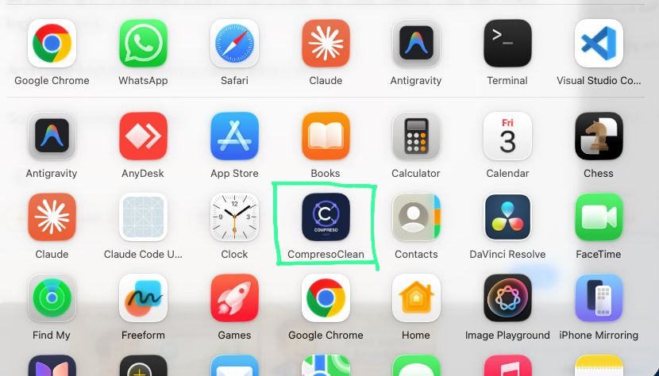
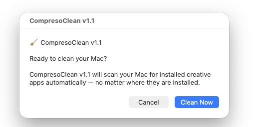
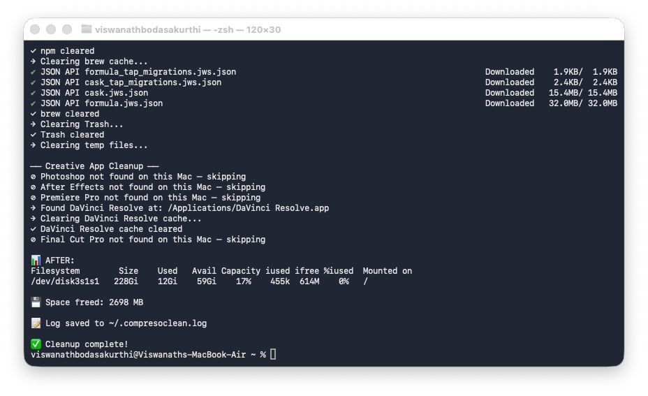
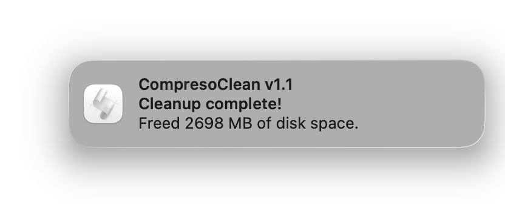

# CompresoClean

[](LICENSE)

A free, open-source, no-subscription **macOS cleaner and disk space cleanup tool** for professionals and developers.  
Built by [Viswanath Bodasakurthi](https://viswabnath.github.io/portfolio/) · [OneMark Agency](https://onemark.co.in)

> A free CleanMyMac alternative — no paywalls, no accounts, no background daemon, no bloat.

---

## What It Does

CompresoClean is a lightweight macOS cache cleaner and junk file remover that frees up disk space in seconds. It was built for the OneMark team and is now open-sourced for anyone who's tired of paying for software that does something a well-written, fully readable shell script can do better.

Beyond the basics (system caches, logs, Trash, temp files), it goes after the disk hogs that generic Mac cleaners usually miss: **Xcode's DerivedData and CoreSimulator caches**, **Android Studio/Gradle build caches**, and 28+ creative apps (Adobe Creative Cloud, Apple Pro Apps, DaVinci Resolve, Blender, Figma, and more) — plus a Smart Scan that ranks *every* installed app on your Mac by how much reclaimable cache it's hoarding, so you can decide what to clean instead of guessing.

| Feature | Details |
|---|---|
| Caches & Logs | Clears system caches, app logs, and temp files |
| npm & Homebrew | Prunes package manager leftovers |
| Trash | Empties system Trash |
| Creative Apps | Dynamically detects and cleans 28 creative apps across Adobe, Apple, 3D, design, audio, and photo categories |
| Smart Scan | Scans every installed app (not just the curated list), ranks them by reclaimable cache/log/junk size, and lets you type which heavy apps to clean from a numbered list (`1,3,5`, `all`, or skip) — apps and real data are never touched |
| Developer Tools | Explicit Xcode (DerivedData, CoreSimulator caches, **all** simulator devices + runtime disk images, iOS DeviceSupport) and Android (Gradle caches, **all** AVDs + SDK system-images/emulator) cleanup — these live outside Smart Scan's generic locations and can easily run into double-digit GB. Simulators/AVDs are treated as regenerable, not permanent — see FAQ |
| Hidden Dotfile Caches | CLI/Electron-style tools that cache directly under `~/.foo` instead of `~/Library/Caches` — npx, Flutter/Dart (`~/.pub-cache`, `~/.dartServer`), generic `~/.cache`, and Antigravity IDE's agent recordings/conversation history — invisible to Smart Scan, handled explicitly |
| Dynamic Detection | Uses Spotlight (`mdfind`) — finds apps regardless of install location or version year |
| Run Logs | Every cleanup logged to `~/.compresoclean.log` with timestamps |
| Notifications | macOS notification shows MB freed after each run |
| Confirmation Dialog | Asks before cleaning — no accidental wipes |
| Trash Mode | `--trash` or the runtime prompt moves items to `~/.Trash` so a cleanup can be undone |
| Package & Container Caches | pnpm store, Yarn caches, and Docker dangling images + build cache (containers/volumes untouched) |
| Large Files & Orphans | Report-only: largest files over 200 MB and likely leftovers from uninstalled apps — never deleted |
| Dry Run | "Preview (Dry Run)" button (or `bash src/CompresoClean --dry-run`) lists what would be removed and estimates the space freed — nothing is deleted |

---

## Screenshots

**App in Launchpad**  


**Confirmation dialog**  


**Terminal output during cleanup**  


**macOS notification after cleanup**  


---

## Installation

### Option 1 — Download DMG (Recommended)

1. Go to [Releases](../../releases) and download `CompresoClean_v1.5.dmg`
2. Open the DMG and drag `CompresoClean.app` to `/Applications`
3. Double-click to run

**First run:** macOS may show a security warning. Go to **System Settings > Privacy & Security** and click **Open Anyway**.

### Option 2 — Build from Source

```bash
git clone https://github.com/viswabnath/CompresoClean.git
cd CompresoClean
chmod +x build.sh
./build.sh
```

This assembles the `.app` bundle and outputs a DMG to `~/Desktop/CompresoClean_v1.5.dmg`.

---

## Editing the Script

The cleaner logic lives in a single shell script:

```
src/CompresoClean
```

To modify and rebuild:

```bash
# 1. Edit the script
nano src/CompresoClean

# 2. Rebuild the app + DMG
./build.sh
```

To edit directly inside the installed app:

```bash
cd /Applications/CompresoClean.app/Contents/MacOS
claude
```

---

## Repo Structure

```
CompresoClean/
├── app/
│   └── CompresoClean.app/       <- Full .app bundle (plug-and-play)
├── src/
│   └── CompresoClean            <- Standalone shell script (source of truth)
├── build.sh                     <- Assembles .app + DMG from src/
├── docs/
│   ├── instructions.md          <- Usage guide
│   └── CHANGELOG.md             <- Version history
├── .gitignore
├── LICENSE                      <- MIT
├── llms.txt                     <- Project summary for AI/LLM tools
└── README.md
```

---

## Run Log

Every cleanup is appended to:

```
~/.compresoclean.log
```

Example entry:

```
[2026-08-25 14:32:01] CompresoClean v1.3 -- Cleanup complete. 3,421 MB freed.
```

---

## Releases

| Version | Date | Notes |
|---|---|---|
| v1.5 | 2026-11 | Dry-run preview mode, optional recoverable Trash mode (`--trash`), pnpm/Yarn/Docker cache cleanup, report-only large-file and orphaned-app-data finders, optional code signing + notarization in `build.sh`; fixed runner version strings |
| v1.4 | 2026-09 | New "Delete ALL iOS simulators + Android emulators? [y/N]" prompt, asked once, before any device data is touched (defaults to No) — covers all iOS simulator devices + runtime images + DeviceSupport, and all Android AVDs + SDK system-images/emulator binary, not just orphaned ones; DerivedData/Gradle/Xcode/Android Studio caches still always run regardless of that answer; added CoreDevice install cache cleanup; added hidden dotfile cache cleanup (`~/.cache`, npx, Flutter/Dart pub-cache + dartServer, Antigravity IDE recordings/conversations/backups) that Smart Scan's `~/Library`-only scan can't see; fixed a silent partial-failure in the standard cache wipe when a cached app bundle contains read-only files |
| v1.3 | 2026-08 | Smart Scan — generic scan of every installed app, ranks by reclaimable size, numbered-list multi-select cleaning, plus explicit Xcode/Android Studio/Gradle cache handling |
| v1.2 | 2026-05 | Expanded to 28 creative apps, bundle ID detection, no-emoji terminal output |
| v1.1 | 2025-06 | Dynamic app detection, macOS notifications, run logging |
| v1.0 | 2025-05 | Initial release |

Full changelog: [docs/CHANGELOG.md](docs/CHANGELOG.md)

---

## FAQ

**Is CompresoClean really free?**  
Yes — MIT licensed, no subscription, no account, no telemetry. Download the DMG or build it yourself from a single readable shell script.

**Is it a safe alternative to CleanMyMac?**  
It only ever deletes caches, logs, saved app state, and known junk folders — never an app itself, and never your documents, projects, or settings. Every curated app cleanup is gated on Spotlight actually detecting that app installed, and Smart Scan shows you exactly what it found before anything is removed.

**Does it clean Xcode's DerivedData and simulator caches?**  
Yes. `DerivedData` and `CoreSimulator/Caches` are always cleared. Actually deleting simulator *devices* and their runtime OS disk images (`xcrun simctl delete all` + `xcrun simctl runtime delete all` — often 10-20GB combined) is a separate, opt-in step: v1.4 asks once, up front, "Delete ALL iOS simulators + Android emulators? [y/N]" (defaults to No) before touching any device data, since both platforms' devices are grouped under the same yes/no choice. Say yes and it also clears per-device debug symbols under `iOS DeviceSupport`. It never touches Xcode Archives (your actual App Store submission builds) — those are real artifacts, not cache, and aren't part of this prompt at all.

**Does it clean Android Studio and Gradle caches?**  
Android Studio's own app caches and `~/.gradle/caches` are always cleared. Your AVDs and the SDK's emulator system-images (often another 10-15GB) are covered by the same simulator/emulator prompt described above — say yes and both platforms' devices go together, say no and both are left alone. The Android SDK toolchain itself (build-tools, platform-tools, NDK, platforms) is never touched either way.

**What is Smart Scan?**  
A generic scan across every app installed on your Mac (not just the curated list), ranking each by how much cache/log/junk it's hoarding. It prints a numbered list in the terminal and you type which ones to clean (`1,3,5`, `all`, or skip) — nothing is cleaned automatically.

**Does it work with apps installed outside `/Applications`?**  
Yes — app detection uses Spotlight (`mdfind`), so it finds apps regardless of install location or version year.

---

## Built With

- **Shell Script** — the entire cleaner is a single `bash` script
- **Claude Code** — used for iterative development inside the terminal
- **hdiutil** — native macOS DMG creation
- **mdfind / Spotlight** — dynamic app path detection

---

## About OneMark

OneMark is a design and engineering agency building tools, platforms, and digital products.  
This tool was built internally and open-sourced because good software should be free.

---

## License

MIT License — use it, fork it, ship it.  
Attribution appreciated but not required.

---

Built by Viswanath Bodasakurthi · OneMark Agency
